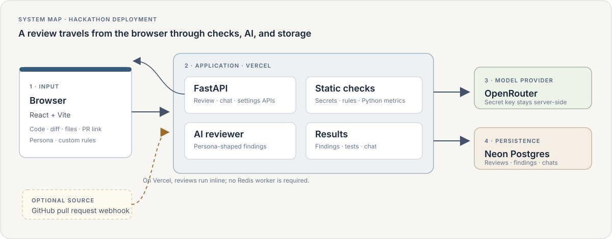
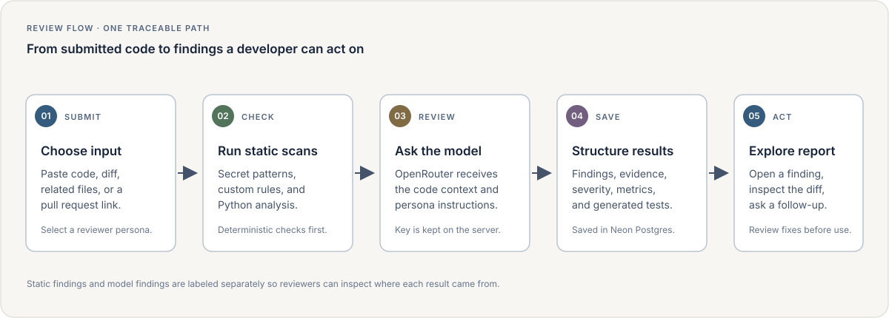

# ReviewCrew  -  https://default-workspace-flax.vercel.app/

### Code review with a reviewer you can tune.

ReviewCrew checks pasted code, diffs, small multi-file projects, and GitHub pull requests. It combines deterministic checks with an AI review, then gives you findings, suggested fixes, metrics, generated tests, and a chat that understands the review.

**Built for a hackathon demo:** React + Vite, FastAPI, Neon Postgres, OpenRouter, and Vercel.



## Start here

| I want to… | Go to… |
| --- | --- |
| Understand what the app does | [Features](#what-you-can-do) |
| Run it on my computer | [Local setup](#run-locally) |
| Deploy the app | [Vercel deployment guide](DEPLOY_VERCEL.md) |
| Find the code for a feature | [Project map](#project-map) |
| Contribute | [Contributing guide](CONTRIBUTING.md) |
| See how a review works | [Review flow diagram](docs/diagrams/review-flow.svg) |

## What you can do

- **Review code** pasted into the composer, a unified diff, multiple related files, or a pull request URL.
- **Choose a reviewer persona** to change the review's emphasis while keeping security and correctness checks active.
- **Catch exposed credentials** with a local secret scanner that masks matched values in findings.
- **Add custom rules** for project-specific patterns and constraints.
- **Inspect findings** by severity, evidence, confidence, and changed line, with suggested fixes and before/after diffs.
- **Explore a diff** with file navigation and finding annotations.
- **Generate pytest tests** from reviewed code.
- **See code metrics**, including Python complexity and maintainability estimates.
- **Ask follow-up questions** in a saved, review-aware conversation.
- **Connect GitHub** to receive pull request webhooks and optionally post review comments with a configured token.



## Run locally

### Requirements

- Python 3.11 or newer
- Node.js 20 or newer
- An OpenRouter API key for AI-powered reviews and chat (static checks can run without one)

### 1. Create your local settings

From the project folder, in PowerShell:

```powershell
Copy-Item .env.example .env
notepad .env
```

For a quick local run, set these values in `.env`:

```ini
DATABASE_URL=sqlite+pysqlite:///./reviewcrew.db
CELERY_TASK_ALWAYS_EAGER=true
OPENROUTER_API_KEY=paste-your-key-here
```

Keep `.env` on your computer. It is ignored by Git. Never paste a real key into source code or a public issue.

### 2. Install and start the backend

Open a PowerShell window in the project folder:

```powershell
py -m venv .venv
& ".\.venv\Scripts\python.exe" -m pip install -r backend\requirements.txt
Set-Location backend
& "..\.venv\Scripts\python.exe" -m alembic upgrade head
& "..\.venv\Scripts\python.exe" -m uvicorn app.main:app --reload --port 8000
```

The API is at `http://localhost:8000`; its interactive docs are at `http://localhost:8000/docs`.

### 3. Start the website

Open a second PowerShell window:

```powershell
Set-Location "C:\path\to\default-workspace\frontend"
npm ci
npm run dev
```

Open the local address printed by Vite (usually `http://localhost:5174`). Keep both windows open while using the app.

## Deploy to Vercel

Follow [DEPLOY_VERCEL.md](DEPLOY_VERCEL.md). The hosted version uses Neon Postgres for saved reviews and chats. Configure `DATABASE_URL`, `OPENROUTER_API_KEY`, and the deployment settings in Vercel; reviews run inline there, so a Redis worker is not required.

## Project map

```text
.
├── backend/
│   ├── app/
│   │   ├── routers/       # HTTP endpoints for reviews, chats, rules, settings
│   │   ├── services/      # static analysis, AI review, metrics, test generation
│   │   ├── tasks/         # review pipeline
│   │   ├── models.py      # database tables
│   │   └── config.py      # environment-based settings
│   ├── alembic/           # database schema migrations
│   ├── scripts/           # demo data and webhook helpers
│   └── tests/             # backend checks
├── frontend/
│   └── src/
│       ├── components/    # composer, findings, diff, navigation
│       ├── pages/         # chat, review detail, settings
│       └── lib/           # API, chat streaming, formatting, theme
├── docs/diagrams/         # hand-built SVG architecture and flow diagrams
├── DEPLOY_VERCEL.md       # beginner-friendly hosted setup
├── CONTRIBUTING.md        # coding and contribution notes
├── docker-compose.yml     # local Postgres and Redis option
└── vercel.toml            # frontend/backend routing for Vercel
```

## How the review works

1. The app accepts code, files, a diff, or a pull request URL.
2. FastAPI runs static checks, secret scanning, custom rules, and Python metrics.
3. The AI reviewer adds contextual findings using the configured provider and persona.
4. Findings, evidence, and review context are saved to Postgres.
5. The interface displays the results, generated tests, diff annotations, and follow-up chat.

For Vercel, the review task runs inline in the request (`CELERY_TASK_ALWAYS_EAGER=true`). For local queue-based development, Docker Compose provides Postgres and Redis with a Celery worker.

## Security and demo notes

- Never commit `.env`, `.env.local`, database files, or API keys. `.gitignore` excludes them.
- The secret scanner detects likely credentials in submitted code; it is a safeguard, not a substitute for a dedicated secret-management workflow.
- The code playground does not execute submitted code on the backend.
- The public demo currently has no sign-in. Anyone with its URL can use the shared app and its configured model key. Keep the deployment link limited to the hackathon audience and rotate any key that is exposed.
- AI findings can be wrong. Review suggested changes before applying them.

## License

[MIT](LICENSE)
